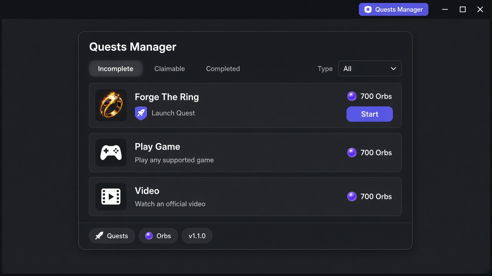

# Quests Manager

**Discord Quest Auto Completer** — a Vencord userplugin that enrolls, tracks, and completes Discord Quests from a panel opened by the **Quests Manager** button in the Discord title bar.

**Current version:** `v1.1.0`



---

## What it does

Open Discord, click the purple **Quests Manager** pill in the title bar, and work from one panel:

- **Incomplete**, **Claimable**, and **Completed** tabs, each with live quest and Orb counts
- A **Type** filter on every tab (All, Launch Quest, Play Game, Video, Stream, Other). The default is **All**
- Country and region filtering, Orb totals, and a Nitro credit chip
- English and Arabic
- **Complete All** for eligible quests, plus per-quest Start and Stop
- An in-plugin updater that installs the latest GitHub release without re-running the installer

### Launch Quest

Launch Quest listings (including a second listing for the same activity, such as a regional duplicate) complete from the card you click.

1. Click **Start**, then **Start Quest**.
2. Allow the activity to open and finish any Discord authorization prompt.
3. Checkpoints run on their own. The default pace is **6 seconds**, the fastest gap that still reaches Discord. You can raise it in settings (6–600 seconds).

Progress stays on the listing you started. A sibling listing that is already finished does not count as this run, and the card does not borrow that sibling’s progress.

Video, desktop play, and stream quests are still completed from the same panel.

---

## Requirements

- Discord **desktop** (Stable) on Windows
- Vencord **built from source** (installer-only Vencord does not load userplugins)
- Node.js, Git, and pnpm (the `.bat` installer can set these up)

Launch Quest needs `native.ts` inside that source build so the plugin can talk to the activity frame.

---

## Quick install (Windows)

1. Download **`Install-Vencord-Quests-Manager.bat`** from the [latest release](https://github.com/Afrsto/Discord-Quest-Auto-Completer/releases/latest).
2. Double-click it. It works as a normal user or as Administrator. If patching fails, run it at the same privilege level as Discord.
3. When Discord is back:
   - Open **Settings → Vencord → Plugins**
   - Enable **Quests Manager**
   - Click **Quests Manager** in the title bar

The installer clones Vencord to `%USERPROFILE%\Documents\Vencord`, installs this plugin from the latest GitHub release, builds, and patches Discord.

---

## Manual install

1. Clone [Vencord](https://github.com/Vencord/Vencord) and run `pnpm install`.
2. Copy `src/userplugins/questsManager/` to `<Vencord>/src/userplugins/questsManager/`.
3. Run `pnpm build` in the Vencord root.
4. Patch Discord with `patch-discord.mjs` from this repo, or your usual Vencord patch method.
5. Restart Discord and enable **Quests Manager**.

---

## Updates

The panel shows **`v1.1.0`** and checks [GitHub Releases](https://github.com/Afrsto/Discord-Quest-Auto-Completer/releases).

1. Click **Check update**.
2. If a newer release includes `src.zip`, click **Update now**.
3. Fully restart Discord.

That replaces the plugin under your local Vencord userplugins folder and rebuilds Vencord. It does not re-run the full installer.

---

## Project layout

```
├── Install-Vencord-Quests-Manager.bat  # Windows installer
├── patch-discord.mjs                   # Discord Stable patcher
├── src/userplugins/questsManager/      # Vencord plugin source
├── docs/images/                        # Panel screenshots
├── scripts/                            # Console / userscript build helpers
├── Quests Manager.txt                  # Optional DevTools paste script
└── Quests Manager.user.js              # Optional Tampermonkey userscript
```

---

## Contact

| Channel | Link | Role |
|---------|------|------|
| **Discord Server** | [https://discord.gg/btRCeujadA](https://discord.gg/btRCeujadA) | Primary community and support |
| **Telegram** | [https://t.me/X2_616](https://t.me/X2_616) | Direct contact and updates |
| **Discord Profile** | [https://discord.com/users/994817247061225633](https://discord.com/users/994817247061225633) | Additional contact |

---

## Credits

- Author: **X2 Salah**
- Repository: [Afrsto/Discord-Quest-Auto-Completer](https://github.com/Afrsto/Discord-Quest-Auto-Completer)

## License

Plugin sources follow Vencord’s GPL-3.0-or-later SPDX headers where present. Use responsibly and at your own risk. This project is not affiliated with Discord.
